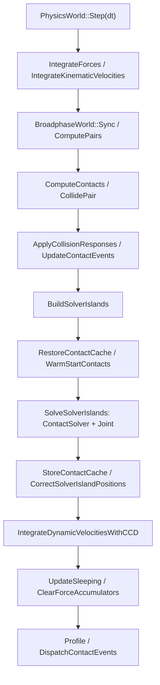

# A rigid-body step, from spatial candidates to solved contacts

This companion to the [file-by-file reading order](SOURCE_READING_ORDER.md)
follows the **actual entry points in the current source**, rather than presenting
collision detection as a single black box. It is educational documentation of
the present implementation, not proof that every shape combination, host or
numerical edge case has been validated. Open each linked file while reading.

## 1. What is owned by each repository?

[KairoMath](https://github.com/swayam8624/KairoMath) supplies vectors,
quaternions and matrices, including coordinate/rotation conventions.
[KairoPhysicsMath](https://github.com/swayam8624/KairoPhysicsMath) supplies
mass, inertia, force, impulse and numerical constraint helpers.
[KairoGeometry](https://github.com/swayam8624/KairoGeometry) supplies geometric
shape and query mathematics. [KairoSpatial](https://github.com/swayam8624/KairoSpatial)
supplies spatial indices such as `DynamicAABBTree` and triangle-mesh BVHs.

**This repository** owns the authoritative body/collider/joint arrays,
simulation policy, orchestration, events, solver caches, and debug/replay
state. A spatial index does *not* own the body it indexes. A collider pair
does *not* prove a contact. A contact record does *not* itself move a body.



The diagram reflects [`PhysicsWorld::Step`](../PhysicsWorld.cppm).
The ordering of `export import` declarations in
[`KairoPhysicsEngine.cppm`](../KairoPhysicsEngine.cppm) is a *module interface*
order, not a simulation schedule.

## 2. Body IDs, collider IDs, and changing topology

Start with [`PhysicsEngineTypes.cppm`](../PhysicsEngineTypes.cppm),
[`RigidBody.cppm`](../RigidBody.cppm) and [`Collider.cppm`](../Collider.cppm).
A rigid body has dynamic/static/kinematic behavior and a motion state.
A collider identifies a particular shape attached to a body, with its own
local transform, material, filters and trigger/response attributes.

A body may own **multiple colliders**. A contact therefore records
`BodyA/BodyB` *and* `ColliderA/ColliderB`; replacing the collider IDs with
body IDs would conflate shapes with possibly different response policies.
The world checks active state and ID bounds before many operations.
Study `CreateRigidBody`, `AddCollider`, `RemoveCollider`, and
`DestroyRigidBody` before making assumptions about handle lifetime.

## 3. Broadphase: a conservative and updateable spatial index

Read [`Broadphase.cppm`](../Broadphase.cppm) beside
[`KairoSpatial/DynamicAABBTree.cppm`](https://github.com/swayam8624/KairoSpatial/blob/docs/teaching-walkthrough-20261121/DynamicAABBTree.cppm).

`PhysicsWorld` calls `m_Broadphase.Sync(m_Bodies, m_Colliders)`.
`BroadphaseWorld::AddOrUpdateCollider` calculates finite world AABBs and
allocates/updates spatial tree proxies. Infinite colliders instead enter an
auxiliary ID list because they cannot have a finite tree box. The tree's
leaf stores a **tight bound** for the current collider and a larger **fat
bound** used to postpone reinsertion while the collider remains inside it.

`BroadphaseWorld::ComputePairs` gets finite/finite pairs from the tree,
adds finite/infinite combinations, applies active-body, same-body and
collision-filter checks, then canonicalizes and deduplicates IDs.
These are **candidate pairs only**. A sphere and a long box can overlap
their AABBs without their actual surfaces touching.

Important query distinction: `QueryAABB` on this broadphase asks the
finite tree only, whereas `QueryAABBCandidates` and
`RaycastCandidates` explicitly include infinite colliders. Tree rebuild
and proxy reallocation must be coordinated: `DynamicAABBTree::RebuildBottomUp`
can invalidate external `SpatialIndex` handles.

**Study experiment:** Move a sphere slightly without leaving its fat
AABB, then far enough that reinsertion is needed. Compare proxy IDs,
tree height, candidate pairs and shape-tested contacts. Run the Spatial
suite before concluding that changes preserve index invariants.

## 4. Narrowphase: shape mathematics, not just box overlaps

[`Narrowphase.cppm`](../Narrowphase.cppm) receives `BroadphasePair` IDs
and uses `CollidePair` to dispatch according to collider shape. It
rejects inactive/missing bodies and only forwards manifolds with points.
A valid `ContactManifold` needs compatible body/collider IDs,
a contact point, nonnegative penetration depth, and a consistent
contact-normal direction.

### Boxes and the separating axis theorem

An oriented box is represented by a center, three basis axes and
half-extents. For a unit test axis `n`, its projected radius is

```text
r = |dot(n,axis0)| * halfExtentX
  + |dot(n,axis1)| * halfExtentY
  + |dot(n,axis2)| * halfExtentZ

overlap = projectedRadiusA + projectedRadiusB
        - |dot(centerB-centerA, n)|
```

If any candidate axis has nonpositive overlap, the boxes separate.
For two 3D OBBs, `FindBoxBoxSAT` checks **3+3+9 = 15** face and
cross-edge candidate axes. Near-degenerate axes are skipped. If no
separating axis is found, the minimum positive overlap helps choose
a response normal. `BuildBoxBoxContacts` then chooses contact points,
and `ReduceContactPoints` keeps the deepest point before selecting
spatially spread points. This is a compact solver manifold, not a
complete representation of the intersection volume.

### Triangle meshes and convex approximations

Triangle mesh paths call into KairoSpatial's BVH traversal to obtain
candidate triangle IDs. The code builds thin convex collision prisms
around triangles and evaluates convex penetration. For the mesh/mesh
and mesh/convex paths inspected here, the deepest qualifying candidate
is retained. These results are **approximations**; they should not be
presented as exact triangle/triangle manifolds.

When `CollidePair` swaps collider order to reuse a shape-specific path,
it reverses returned normals. Missing that reversal would invert the
sign of impulses applied by the solver.

**Study experiment:** Test separated OBBs, touching edges, face overlaps,
very thin rotated boxes, and near-parallel edges; compare contact points
and penetration against independent geometry checks. Test mesh contacts
with several candidate triangles rather than only a single isolated face.

## 5. Collision policy, triggers, and game events

After `ComputeContacts`, `PhysicsWorld::Step` invokes
`ApplyCollisionResponses` and `UpdateContactEvents`.
Geometry determines possible touch; filters, trigger flags, per-collider
or layer response rules decide whether it should block, overlap or be
ignored according to world policy. `PhysicsContactEvent` carries
body/collider IDs plus `Begin`, `Stay` or `End` state.

Triggers can still support gameplay overlap events, but
[`SolveContactManifold`](../ContactSolver.cppm) immediately returns
for `IsTrigger`, avoiding normal/friction blocking impulses. Listener
callbacks are dispatched **after** solver arrays and timing snapshots are
finished. The world refuses recursively nested steps during callbacks.

## 6. Building islands: what can actually run in parallel?

[`SolverIsland.cppm`](../SolverIsland.cppm) uses disjoint-set/union-find
to group **dynamic** bodies connected by non-trigger contacts and active
joints. Static/kinematic bodies can serve as anchors to several islands;
they do not by themselves connect two dynamic groups.

Each island stores dynamic body IDs and **indices into the current**
contacts/joints vectors, not copies of the constraints. No island should
be retained across a changing topology. The optional `std::jthread`
dispatcher distributes island indices using an atomic counter, with
threads joined on scope exit. Correctness relies on different islands
not mutating the same dynamic body or joint state. A future solver
callback that writes to shared static/kinematic state could violate
this parallelism assumption.

Within an island, `VelocityIterations` repeatedly solve contact
manifolds and then joints. A separate `PositionIterations` phase
corrects remaining penetration/constraint positions.

## 7. Sequential impulses, effective mass, and warm starting

[`ContactSolver.cppm`](../ContactSolver.cppm) consumes
`ContactNormalDenominator`, `ApplyImpulseAtPoint`, and
`ClampAccumulatedImpulseDelta` from KairoPhysicsMath.

For a contact at world position `p`, define offsets from each body
center as `rA=p-xA` and `rB=p-xB`. The relative velocity at the point
includes both translation and rotation. The normal effective-mass
denominator incorporates linear inverse mass plus angular inertia
terms of the form `(r × n) · I_world^-1 (r × n)`.

A requested normal impulse is converted into a **delta** to the
accumulated impulse, which is clamped nonnegative. Equal and opposite
impulses are applied at the contact point. Friction uses the velocity
component tangent to the contact and clamps its scalar impulse
relative to the accumulated normal impulse.

**Read the implementation before extending it:** the current friction
path reuses the normal denominator for the tangent update, stores one
scalar tangent impulse, and reconstructs its direction on warm start.
It also skips further tangent work for a point when the newly computed
normal-impulse delta is extremely small. These are concrete behaviors
worth dedicated regression tests and comparison with a two-tangent
solver; they are not claims of physically exact friction.

`PhysicsWorld` restores cached impulses before solving and stores
the new cache afterward. Position correction then mitigates residual
penetration. Neither warm starting nor Baumgarte correction is a
substitute for continuous collision detection.

## 8. Motion, fixed timesteps, CCD and profiling

After the constraint passes, the world calls
`IntegrateDynamicVelocitiesWithCCD(dt)`, `UpdateSleeping(dt)`
and `ClearForceAccumulators()`. Supported continuous-motion paths
clip motion using time-of-impact checks rather than treating all
fast-moving objects as only discrete contacts. Verify supported
shape/motion combinations in source and tests.

`Step(dt)` is **one requested step**. `StepFixed(elapsedTime, fixedDt,
maxSubSteps)` accumulates elapsed time and runs up to `maxSubSteps`
fixed calls. When the limit is reached and at least another full step
remains queued, the implementation resets the accumulator to zero.
That is a deliberate responsiveness-over-time-fidelity tradeoff.

`PhysicsStepProfile` records total, broadphase, narrowphase and solver
wall-clock durations. These measurements are not simulation state and
must be compared only using controlled workloads, compiler options,
threading settings and hardware.

## 9. Reproducible reading and testing sequence

Read [`tests/PhysicsEngineTests.cpp`](../tests/PhysicsEngineTests.cpp),
[`tests/PhysicsStressTests.cpp`](../tests/PhysicsStressTests.cpp),
[`tests/CharacterControllerTests.cpp`](../tests/CharacterControllerTests.cpp)
and [`tests/VehicleSystemTests.cpp`](../tests/VehicleSystemTests.cpp).
Use the terminal examples via
[`sandbox/examples/main.cpp`](../sandbox/examples/main.cpp) and
[`sandbox/DemoScene.cppm`](../sandbox/DemoScene.cppm).

For each experiment, write down **expected behavior first**, then
actual contact-pair IDs, manifold count, normal directions,
penetration depths, body velocities, accumulated impulses, island
membership and elapsed phase timings. Distinguish the source-defined
behavior from the subset you actually executed.

A useful validation progression is: one falling sphere → sphere/sphere
collision → box stack with warm starting → friction ramp → sleeping →
trigger without physical response → fast swept projectile → dense
stress scene. Repeat with and without parallel islands, record numerical
differences, and inspect [the spatial data structures](https://github.com/swayam8624/KairoSpatial/blob/docs/teaching-walkthrough-20261121/docs/SOURCE_READING_ORDER.md)
when candidate pairs or performance seem surprising.

**Verification status:** this walkthrough was written from source review
on the teaching branch. It does not claim a successful compilation,
test run, physics certification or benchmark on a particular host.
